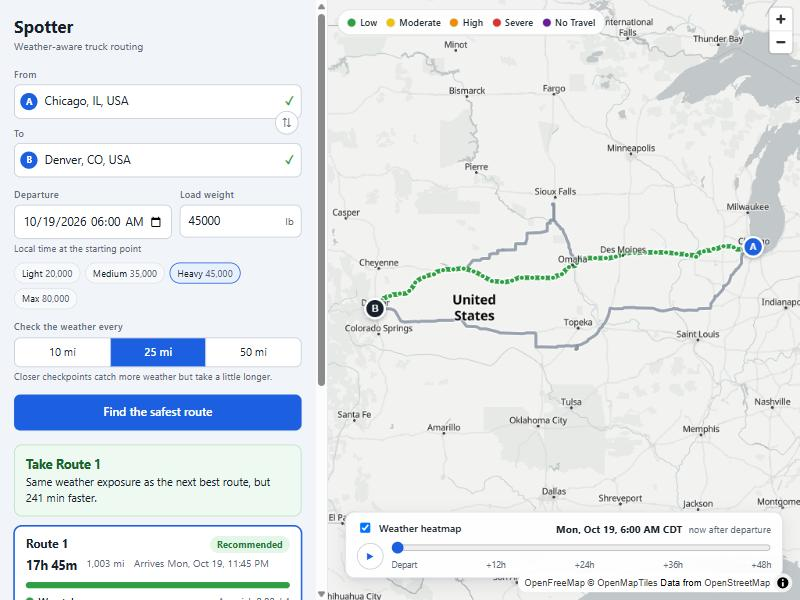
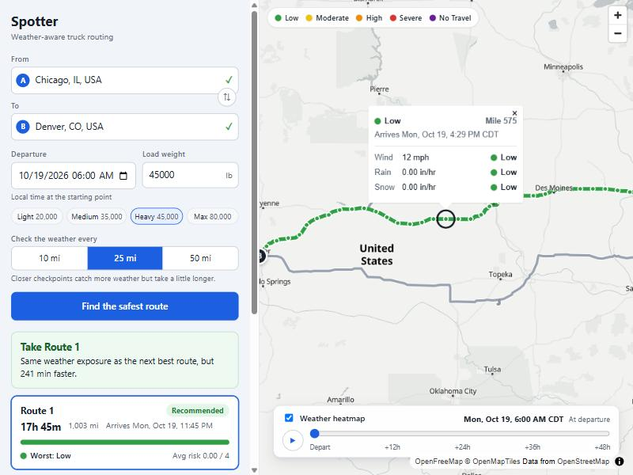
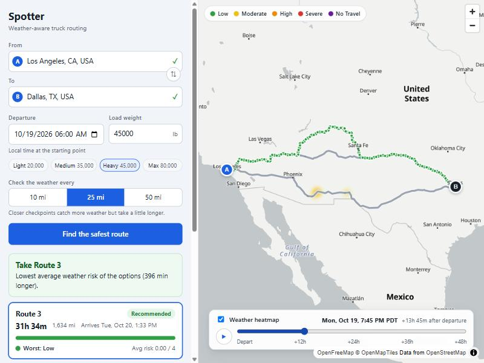
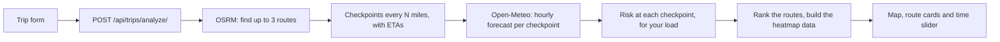

# Spotter: weather-aware truck routing

Pick a start, a destination, a departure time and how heavy the load is. Spotter finds up to three
routes, works out where the truck will be and when, checks the forecast for those places at those
times, and tells you which route is safest.

The idea behind it is simple. A truck leaving Chicago at 6 am won't reach Nebraska until the afternoon,
so the weather in Nebraska at 6 am doesn't matter. The forecast for the hour the truck actually gets there does.



## Contents

- [What it does](#what-it-does)
- [Running it](#running-it)
- [Configuration](#configuration)
- [How it works](#how-it-works)
- [Decisions, and why I made them](#decisions-and-why-i-made-them)
- [The API](#the-api)
- [Project layout](#project-layout)
- [Tests](#tests)
- [Limitations and what I'd do next](#limitations-and-what-id-do-next)
- [References and credits](#references-and-credits)
- [How this was built](#how-this-was-built)

---

## What it does

You enter a start, a destination, a departure time and a load weight. Spotter then:

- finds **three route options** (fewer when a trip really only has one or two sensible roads)
- places **weather checkpoints** along each route, every 10, 25 or 50 miles (you choose)
- works out the **arrival time at each checkpoint** and looks up the hourly forecast for that exact
  place and hour
- scores the weather at every checkpoint (**Low, Moderate, High, Severe or No Travel**), taking your
  load weight into account
- **recommends one route** and says why, in one sentence
- draws everything on a map: the routes coloured by risk, the checkpoints, their ETAs and weather, and a
  **heatmap of bad weather with a 0 to 48 hour slider**

Clicking a checkpoint shows exactly what the truck will face there and when:



The heatmap shows where the bad weather is at any time in the next 48 hours, so you can see how it moves
across the routes. Here it is about 14 hours after departure, with two storm cells over Arizona and New Mexico:



---

## Running it

You need **Python 3.12 or newer** and **Node 20 or newer** (I used Python 3.13 and Node 24).
The only key you need is a free [openrouteservice](https://openrouteservice.org/) token, which is used for
address search. Routing and weather need no key.

### 1. The backend

```bash
cd backend
python -m venv .venv
```

Activate the virtual environment: `.venv\Scripts\Activate.ps1` in PowerShell, or `source .venv/bin/activate`
on macOS and Linux. Then:

```bash
pip install -r requirements.txt
```

Create a file called `.env` in the `backend` folder. It only needs one line to get going:

```
ROUTING_KEY=your-openrouteservice-token
```

Then start the server:

```bash
python manage.py runserver
```

It runs on http://localhost:8000. You can check it with http://localhost:8000/api/health/.

### 2. The frontend

In a second terminal:

```bash
cd frontend
npm install
npm run dev
```

Open http://localhost:5173. In development, the frontend forwards anything under `/api` to the backend,
so there is nothing to configure.

### 3. Try it

Search for two cities (for example Chicago and Denver), leave the defaults and press **Find the safest route**.
It takes about 6 to 8 seconds, because it is waiting on two free public services. A trip departing
tomorrow morning is a good first test.

---

## Configuration

Everything has a sensible default. For local development, `ROUTING_KEY` is the only thing you must set.

**Backend (`backend/.env`)**

| Variable | What it does | Default |
|---|---|---|
| `ROUTING_KEY` | Your openrouteservice token. Used for address search. | none, address search is disabled without it |
| `ROUTING_PROVIDER` | Which service builds the routes. Only `osrm` exists so far. | `osrm` |
| `OSRM_BASE_URL` | Where the routing service lives. Point it at your own OSRM server for real traffic. | the public OSRM demo server |
| `SECRET_KEY` | Django's signing key. Nothing important is signed in this app, but set a real random one when you host it. | a development-only value |
| `DEBUG` | Detailed error pages. Keep it off when hosted. | `false` |
| `ALLOWED_HOSTS` | Host names the API will answer to, comma separated. | `localhost,127.0.0.1` |
| `CORS_ALLOWED_ORIGINS` | Where the frontend is hosted, comma separated. | `http://localhost:5173` |

`backend/.env.example` lists all of them.

**Frontend**

| Variable | What it does |
|---|---|
| `VITE_API_URL` | Where the API lives when the frontend is hosted separately, for example `https://spotter-api.example.com`. Leave it empty in development. |

---

## How it works



In words:

1. **Find routes.** Ask OSRM for a route, and for a few forced detours so there are real alternatives.
   Keep the three that differ most.
2. **Place checkpoints.** Walk along each route and drop a checkpoint every N miles. The time the truck
   reaches each one comes from the road's own segment-by-segment travel times.
3. **Get the forecast.** One batched lookup of hourly wind, rain and snow for every checkpoint.
4. **Score the weather.** For each checkpoint, take the forecast for the hour the truck arrives, and apply
   the brief's thresholds and load rules.
5. **Compare and recommend.** Add up how many miles of each route are at each risk level, rank the
   routes, and write a one-line reason.
6. **Show it.** Everything comes back in one response, including the risk level at every checkpoint for
   each of the next 48 hours, so the heatmap slider never has to ask the server anything.

---

## Decisions, and why I made them

Most of these came from something that didn't work the first time. I tried to keep the reasoning
in the open.

### Routing: OSRM, not openrouteservice

I started with openrouteservice (ORS) because it has a proper `driving-hgv` truck profile. Two things
ruled it out when I tested the public API:

- Its "alternative routes" feature **refuses any trip over 100 km**, and truck trips are often 1,000 km or more.
- A single truck route from Los Angeles to Dallas took **about 99 seconds** to come back, and a few other
  calls timed out at 100 seconds. That is far too slow for a web page.

OSRM answers in about a second. I also looked at Mapbox Directions: it returns at most two alternatives
and has no truck profile either, so it wasn't a clear improvement. ORS is still used for **address
search**, where it works well.

OSRM only ever gives one or two routes, and they are often almost identical. To get a real third option,
Spotter also asks OSRM for trips that must pass through a point pushed off to the side of the main road, in
four different positions. Then it keeps the three routes that share the least road with each other:

- a route is dropped if it takes **more than 1.6 times as long** as the fastest
- two routes count as "the same" if **more than 80% of the road** is shared

Those limits are deliberately generous. The whole point of the app is that a much longer route can be the
right call when the short one runs into a storm. Strict limits just left many long trips with only two routes.

OSRM models cars, and cars go faster than loaded trucks, so every road segment is capped at **62 mph**
before travel times are worked out.

### Checkpoints and arrival times

A checkpoint is placed every 10, 25 or 50 miles (25 by default). Closer checkpoints catch more weather but
take a little longer. The arrival time at each one comes from adding up the real travel time of every
small segment of road before it, not from "distance divided by average speed". That is why a slow mountain
pass correctly delays every checkpoint after it.

The departure time you type is **local time at the starting point**, and every time on screen is shown in
that same zone.

### The weather timing rule

Weather comes from [Open-Meteo](https://open-meteo.com/), as hourly values. The subtle part is which hour to read:

- **Wind** is a reading at one instant, so a truck arriving at 06:20 uses the **nearest hour** (06:00).
- **Rain and snow** are totals for the hour **before** each timestamp. The rain that falls while the
  truck is passing at 06:20 is inside the 07:00 value, so those use the hour that **ends after** arrival.

Open-Meteo's free service is the weak link of the whole app, so the client is careful with it:

- requests are split into **small batches of 15** and sent in parallel, because big batches were very
  slow (100 locations took over 30 seconds in my tests)
- coordinates are rounded to a grid of about 7 miles, so overlapping routes share lookups and a longer trip
  stays under the rate limit
- a failed request is **retried twice**, since the service sometimes answers "overloaded"
- results are **cached for 30 minutes**, so changing only the load weight costs no new lookups

### The risk rules

These are the thresholds from the brief. Each checkpoint takes the **worst** of the three conditions.

| Condition | Low | Moderate | High | Severe | No Travel |
|---|---|---|---|---|---|
| Wind | under 25 mph | 25 to 34 | 35 to 44 | 45 to 54 | 55 mph or more |
| Rain | under 0.10 in/hr | 0.10 to 0.25 | 0.25 to 0.50 | 0.50 to 1.00 | over 1.00 |
| Snow | under 0.5 in/hr | 0.5 to 1.0 | 1.0 to 2.0 | 2.0 to 3.0 | over 3.0 |

**Load rules.** These only change wind:

- 55 mph or more is No Travel for any load
- 45 to 54 mph with a load **over 30,000 lb** is No Travel
- 35 to 44 mph with a load **over 40,000 lb** is Severe

**Where the brief is ambiguous**, the convention I used:

- The bands in the table share their edges (0.25 appears in both Moderate and High). **Every band includes
  its lower edge**, so 25 mph is Moderate and 0.25 in/hr of rain is High.
- Wind is No Travel from exactly 55 mph (the brief says "55 or more"). Rain and snow are No Travel only
  **above** 1.00 and 3.0 (the brief says "greater than"), so exactly 1.00 in/hr of rain is still Severe.
- The load rules say "over", so a load of exactly 30,000 lb is **not** heavy.

A route's totals come from giving each checkpoint the stretch of road halfway to its neighbours on each
side. From that I count the miles at each level, plus an **average risk** on a 0 to 4 scale (Low is 0,
No Travel is 4), weighted by miles.

### Ranking the routes

Routes are ranked in exactly the order the brief gives:

1. fewest Severe miles
2. fewest High miles
3. lowest average risk
4. shortest travel time

Each step only matters when the one before it is tied, so **weather always outranks time**. There are two
small details. Miles of No Travel weather **count as Severe miles**, since it is the far end of the same
scale (without that, a route you can't drive could beat one with a single Severe mile). And values are
rounded to a hundredth of a mile before comparing, only so floating point noise can't pick a winner.

**The honest consequence:** because weather beats time, a small patch of weather can outweigh a big time
saving. In a live Los Angeles to Dallas run, one direct route had a single 25 mile stretch of rain, and a
clean detour took six and a half hours longer. By the brief's order the detour ranks higher. I considered
adding a tolerance for tiny exposures, but decided to follow the brief as written. The app is open about the
trade-off: the recommendation says what avoiding the weather costs (for example "Avoids 25 miles of
high-risk weather compared with the next best route (400 min longer)"), and each route's time and weather
are shown side by side, so a dispatcher can make a different call.

### The heatmap

The heatmap shows the risk level at every checkpoint location for each of the next 48 hours, for the load
you entered. The server sends all 49 hours up front, stored as one value per hour on each point. Dragging
the slider then only changes which hour the map reads, and blends smoothly between neighbouring hours.
There are no requests and no data reloads while it moves or plays (about 4 ms per update in a development build).

---

## The API

There are two endpoints that matter, plus a health check.

**`POST /api/trips/analyze/`**

```json
{
  "origin": { "lat": 41.8781, "lon": -87.6298, "label": "Chicago, IL" },
  "destination": { "lat": 39.7392, "lon": -104.9903, "label": "Denver, CO" },
  "departure": "2026-11-03T06:00",
  "load_lb": 45000,
  "interval_miles": 25
}
```

- `departure` with no offset is **local time at the origin**. With an offset (`-08:00`, `Z`) it is used as
  given. It can be up to 14 days ahead and not more than an hour in the past.
- `load_lb` is from 0 to 100,000. `interval_miles` is 10, 25 (default) or 50.
- The response has up to three `routes`. Each has a `rank`, summary totals, risk-coloured `segments` for
  drawing the road, and `checkpoints` with position, ETA, weather and risk. It also has the
  `recommendation` with a one-line reason, and the `heatmap` data.

**`GET /api/geocode/?q=Denver`** returns up to six matching places. Searches under three characters return nothing.

**`GET /api/health/`** returns `{"status": "ok"}`.

<details>
<summary>Error responses</summary>

Errors come back as `{"detail": "..."}`, or as a map of field names for bad input.

| Status | When |
|---|---|
| 400 | Bad input, or a trip that would end after the 16-day forecast does |
| 502 | The routing, weather or address-search service failed |
| 503 | The weather service's rate limit was hit (the response has `Retry-After: 60`), or address search has no key |

</details>

---

## Project layout

```
backend/
  config/              Django settings and the root URLs
  trips/
    services/          where the real logic lives
      risk.py            thresholds and load rules
      recommend.py       route totals, ranking and the recommendation sentence
      routing/           OSRM client, the alternative-route search, the provider switch
      checkpoints.py     checkpoints along a route, and their ETAs
      weather.py         the Open-Meteo client: batching, retries, cache
      analysis.py        ties it all together into one response
      geocoding.py       address search
      geo.py, timezones.py   small helpers
    serializers.py, views.py, urls.py   the HTTP layer
    tests/
frontend/
  src/
    api/               typed client for the two endpoints
    components/        form, map, heatmap controls, route cards, popups
    hooks/, lib/       small hooks, formatting, GeoJSON building, risk colours
    test/              fixtures and test setup
docs/screenshots/      the images used in this README
```

The backend has no database and no accounts. Each request is independent, which kept it simple and
makes it easy to host.

The map is [MapLibre GL JS](https://maplibre.org/), which draws with WebGL. Route geometry sits in
one source, already cut into risk-coloured pieces, so choosing another route only changes which pieces are
drawn in colour. The map is also loaded as its own chunk, so the form appears straight away (about 86 KB
before the map arrives).

---

## Tests

```bash
cd backend && python -m pytest        # 203 tests
cd frontend && npm test               # 68 tests
```

What I tried to test, and how:

- **The rules from the brief** are tested at every boundary, for example 24.9 / 25 / 34.9 / 35 mph, and a
  load of exactly 30,000 lb against 30,001.
- **The risky logic is tested in isolation** with small, hand-built routes and forecasts: ranking, ETA
  interpolation, the weather timing rule, and the batching and retry behaviour of the weather client.
- **External services are always faked** in tests, so they run in a couple of seconds and don't depend on anyone's uptime.
- **I broke the code on purpose** (for example reversing the ranking order, dropping a criterion,
  rounding too coarsely) to check the tests really fail when they should. A few weak tests turned up
  that way and I rewrote them.
- On the frontend, the address search is tested the way a person uses it (typing, arrow keys, Enter,
  Escape), along with the form's validation, the route cards, the API client's error handling and the
  map data building. The map itself isn't unit tested, since WebGL doesn't run in the test environment,
  so I checked it by using it.

Frontend checks: `npx tsc -b` (types), `npm run lint`, and `npm run build`.

---

## Limitations and what I'd do next

I'd rather be upfront about these:

- **Travel times are driving time only.** There are no mandatory rest breaks, so on a trip of a day or
  more the real arrival will be later than shown. The travel times themselves come from a car model
  capped at 62 mph, not a true truck model.
- **Wind uses the sustained wind speed, not gusts.** Gusts matter a lot to a high-sided truck, and would
  be a sensible next step.
- **It relies on free services with limits.** Open-Meteo's free tier allows roughly 600 location
  lookups a minute, the public OSRM server is meant for light use only, and address search takes a few
  seconds per query. They are fine for a demo, not for real traffic. The OSRM server can be swapped with one setting.
- **A request takes 6 to 8 seconds.** Most of it is waiting on those services. The cache helps repeat requests, but it lives inside one process.
- **The forecast only reaches 16 days ahead**, so later trips are rejected with a clear message.
- **The API has no authentication or rate limiting yet.** Before putting it on the open internet I would
  add throttling, since the address search uses a private key.
- **Only tested on trips in the United States.** The thresholds in the brief use miles per hour and inches.
- **The recommendation follows the brief to the letter.** As described above, that can favour a long
  detour over a small patch of weather. A softer "balance" would be an easy change in one file, but
  it is a judgement call that should be made on purpose.

Next, in roughly this order: gust-based wind, rest-break aware ETAs, request throttling, and a way to
show the weather on the map along a chosen route without re-running the search.

---

## References and credits

### Data and services this app uses

| What | Used for | Notes |
|---|---|---|
| [OSRM](https://project-osrm.org/) | Routes and per-segment travel times | Public demo server. Road data © [OpenStreetMap contributors](https://www.openstreetmap.org/copyright) |
| [Open-Meteo](https://open-meteo.com/) | Hourly wind, rain and snow forecasts | Free for non-commercial use, with attribution. **Weather data by Open-Meteo.com** |
| [openrouteservice](https://openrouteservice.org/) | Address search (autocomplete) | Needs a free token |
| [OpenFreeMap](https://openfreemap.org/) | Map tiles (the "positron" style) | Built on OpenMapTiles and OpenStreetMap data |

### Documentation I worked from

- OSRM HTTP API: the `route` service, `alternatives`, and the per-segment `annotations`
- Open-Meteo Forecast API: the hourly variables, units, and the `start_hour` / `end_hour` window
- MapLibre GL JS: the heatmap layer, data-driven expressions, and the source and layer API
- GeoJSON ([RFC 7946](https://datatracker.ietf.org/doc/html/rfc7946)), which is why coordinates are always longitude first
- The [WAI-ARIA combobox pattern](https://www.w3.org/WAI/ARIA/apg/patterns/combobox/), for the address search box
- Django REST framework and TanStack Query docs

### Techniques

- The [haversine formula](https://en.wikipedia.org/wiki/Haversine_formula), for distances between coordinates
- The [Ramer-Douglas-Peucker algorithm](https://en.wikipedia.org/wiki/Ramer%E2%80%93Douglas%E2%80%93Peucker_algorithm),
  to thin a 15,000-point route down to about a thousand points before sending it to the browser
- A simple grid lookup, to check quickly whether two routes follow the same road

### Main libraries

Backend: Django, Django REST framework, django-cors-headers, django-environ, requests, timezonefinder,
pytest, pytest-django. Frontend: React, TypeScript, Vite, MapLibre GL JS, TanStack Query, Vitest, Testing Library.

### Design

I didn't base the look on one particular product. It follows conventions people already know:

- a **sidebar next to a full-height map**, as in most routing tools
- **traffic-light colours** for risk, going from green to red, with **purple for No Travel** so it can't
  be mistaken for just another red
- a **time slider with play and pause** over the map, the same idea as the scrubber on weather-radar apps
- a **stacked colour bar** on each route card so the weather mix reads at a glance

The map's labels stay readable because the routes and heatmap are drawn underneath them. The interface
also works on a phone-sized screen and with a keyboard.

---

## How this was built

I used an AI assistant (Claude) to help plan, write and test this project. I then went through the code
module by module so that I understand how each part works and can explain the decisions above. The tests, the
real-service checks and the notes about what failed first are all things I ran and looked at myself.
